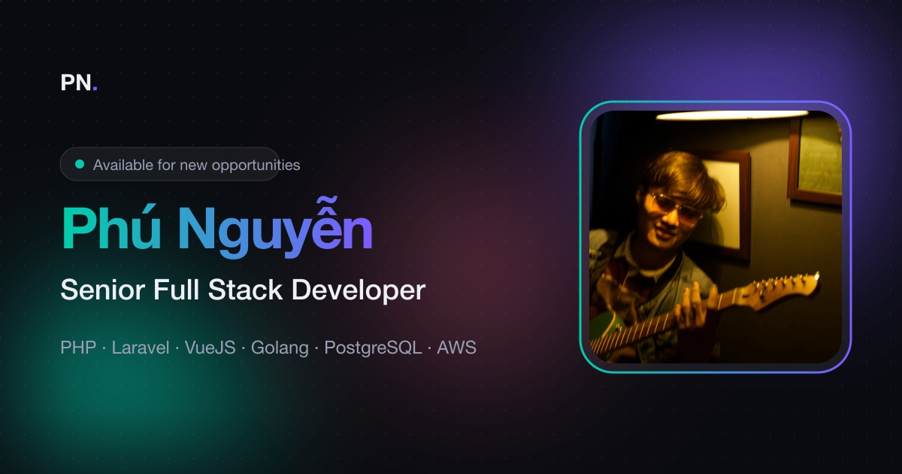

# Phú Nguyễn — Portfolio ⚡️

[Tiếng Việt](README.vi.md) · [](LICENSE.md)

Personal portfolio of **Phú Nguyễn**, Senior Full Stack Developer. A static one-page site in English and Vietnamese, built with Parcel, Sass and vanilla JavaScript, based on the [Simplefolio](https://github.com/cobiwave/simplefolio) template by Jacobo Martínez.

<p align="center">
  
</p>

## Features

- **Liquid glass UI** inspired by Apple's iOS 26: frosted, saturated glass with a specular rim on the navbar, buttons, chips and cards.
- **Edge refraction** (Chromium): each glass surface bends the page behind it near its edges. Other browsers get the frosted glass without the bend.
- **Press feedback**: buttons, icons and the navbar swell and spring back when pressed.
- **Dark and light themes**: follows the system setting, with a toggle that remembers the visitor's choice.
- **English / Vietnamese**: two static pages, `index.html` and `vi.html`, built from one source, so search engines index both. The language button opens the other page at the section you are reading.
- **Mobile tab bar**: on phones the navigation moves to a glass tab bar at the bottom, within thumb reach.
- **Sections**: Hero, About, Experience timeline, Projects bento grid, Contact.
- **SEO and sharing**: each language has its own title, description and canonical URL, and a `hreflang` link to the other language, plus Open Graph and Twitter card tags with a 1200×630 preview image for Facebook, Zalo and others.
- **Light assets**: WebP images, self-hosted variable fonts, no CSS framework and no third-party requests. About 35 kB of CSS and 6 kB of JS after build.
- **Works without JavaScript**: content is only hidden for the reveal animation once scripts run.
- Respects `prefers-reduced-motion`.

## Getting started 🚀

You need [Node.js](https://nodejs.org/) 18 or newer (22 LTS recommended) and npm.

```bash
npm install
npm start
```

Open `http://localhost:1234/`. The Vietnamese page is at `http://localhost:1234/vi.html`.

`npm start` first builds `src/vi.html` from `src/index.html` and the Vietnamese copy. While the dev server runs, rebuild it after a copy change with `npm run i18n`, or keep `npm run i18n -- --watch` running in a second terminal.

### Docker

No Node needed on the host:

```bash
docker compose up --build
```

Open `http://localhost:4869/`. Stop with `docker compose down`.

- Compose publishes `4869:4869`. The container runs `npm start` with `--host 0.0.0.0 --port 4869`.
- `npm start` on the host still uses port 1234. Do not open 1234 for the Docker run.
- The repo is bind-mounted at `/app`. An anonymous volume keeps container `node_modules` off the host tree.
- `CHOKIDAR_USEPOLLING=true` is set so file saves reload through the bind mount.

### Build

```bash
npm run build
```

Output goes to `dist/`, which is emptied first. Asset URLs are relative, so the site works at a domain root or in a sub-folder such as `/simplefolio/`. The build also copies `og-image.jpg` to the root of `dist/`, so the Open Graph link has a stable URL.

`npm run format` formats `src/` and `scripts/` with Prettier. `npm run format:check` only reports.

> If the dev server keeps serving old code after an edit, stop it, delete `.parcel-cache/` and start it again.

## Editing the content 🔧

| What | Where |
|------|-------|
| English copy, links, projects, jobs | `src/index.html` |
| Vietnamese copy | `src/data/translations.mjs` |
| Page title, description, keywords, Open Graph | `<head>` of `src/index.html` (Vietnamese versions: `meta.*` keys in `translations.mjs`) |
| Photo, project images | `src/assets/` (`profile.webp`, `project.webp`) |
| Résumé | `docs/resume.html`, printed to `src/assets/resume.pdf` |
| Colors and theme tokens | `src/sass/abstracts/_variables.scss` |
| Scroll animations | `src/data/scrollRevealConfig.js` |

### Translations

Every translatable element has a key:

- `data-i18n="key"`: plain text.
- `data-i18n-html="key"`: text with markup, such as the gradient name in the hero.
- `data-i18n-<attribute>="key"`: an attribute, such as `data-i18n-content` on a `<meta>` tag, `data-i18n-alt` on an image or `data-i18n-aria-label` on a button.

The English text stays in the HTML. Add the Vietnamese text under the same key in `src/data/translations.mjs`. When you change copy, change both places.

`scripts/build-vi.mjs` merges the two into `src/vi.html`. That file is generated and not committed, so do not edit it. The script stops with an error if a key has no Vietnamese text, or if a Vietnamese text is no longer used.

### Résumé

`docs/resume.html` is the source of the résumé. Edit it, open it in a browser and print it to PDF (A4, no margins, background graphics on) over `src/assets/resume.pdf`.

### Experience

Each job is an `<li class="timeline__item">` inside `<ol class="timeline">`, newest first. The current job's dot uses `timeline__dot--current` to pulse.

### Projects

Each project is an `<article class="bento-card">` inside `<div class="bento">`. The first card has `bento-card--featured` and takes the large tile. Cards stack into two columns on tablets and one on phones.

### Colors

Change `$primary-color` and `$secondary-color` in `_variables.scss` to set the brand gradient. Theme colors (background, text, glass tint) are CSS custom properties in the `theme-dark` and `theme-light` mixins in the same file.

### Liquid glass

- Styles: the `liquid-glass` mixin in `src/sass/abstracts/_mixins.scss`. Use `@include liquid-glass($blur, $shadow)` on any element to turn it into glass.
- Refraction and press effect: `src/scripts/liquidGlass.js`. Add a selector to `SELECTOR` to give an element edge refraction, and to `PRESSABLE` to make it swell when pressed.

### Sharing preview

`src/assets/og-image.jpg` is the image shown when the link is shared. It is 1200×630. If you replace it, keep that size. Its source is `docs/og-image.html`: open it in a browser window sized 1200×630 and save a screenshot of the page.

The `canonical`, `hreflang`, `og:url` and `og:image` tags point to `https://phunguyen4869.github.io/simplefolio/`. If the site is hosted elsewhere, update those URLs in `src/index.html`. The Vietnamese page takes its URLs from the canonical one. Facebook and Zalo need absolute URLs.

After deploying, check the preview with the [Facebook Sharing Debugger](https://developers.facebook.com/tools/debug/). It also refreshes Facebook's cache.

## Deployment 📦

`.github/workflows/gh-pages.yml` builds the site and publishes `dist/` to GitHub Pages. You can also upload `dist/` to Netlify, Vercel or any static host.

## Built with 🛠️

- [Parcel](https://parceljs.org/): bundler
- [Sass](https://sass-lang.com/documentation): styles
- [Fontsource](https://fontsource.org/): self-hosted Inter and Space Grotesk
- `IntersectionObserver` and the Web Animations API: reveal animations
- SVG filters and `backdrop-filter`: liquid glass refraction

## Credits

- Original template: [Simplefolio](https://github.com/cobiwave/simplefolio) by [Jacobo Martínez](https://github.com/cobiwave)
- Portfolio and redesign: [Phú Nguyễn](https://github.com/phunguyen4869)

## License 📄

MIT. See [LICENSE.md](LICENSE.md).
