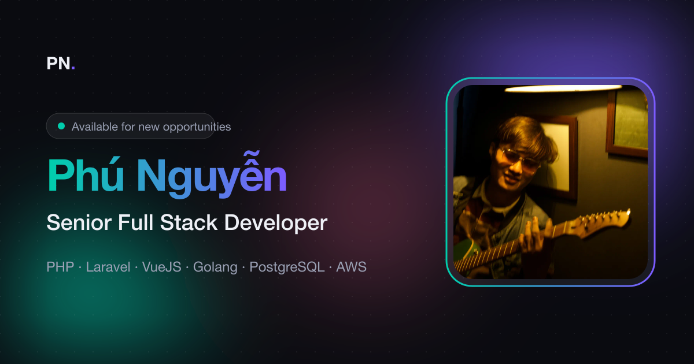

# Phú Nguyễn — Portfolio ⚡️

[Tiếng Việt](README.vi.md) · [](LICENSE.md)

Personal portfolio of **Phú Nguyễn**, Senior Full Stack Developer. A one-page static site built with Parcel, Sass and vanilla JavaScript, based on the [Simplefolio](https://github.com/cobiwave/simplefolio) template by Jacobo Martínez.

<p align="center">
  
</p>

## Features

- **Liquid glass UI** inspired by Apple's iOS 26: frosted, saturated glass with a specular rim on the navbar, buttons, chips and cards.
- **Edge refraction** (Chromium): each glass surface bends the page behind it near its edges. Other browsers get the frosted glass without the bend.
- **Press feedback**: buttons, icons and the navbar swell and spring back when pressed.
- **Dark and light themes**: follows the system setting, with a toggle that remembers the visitor's choice.
- **English / Vietnamese**: one button switches all copy, the page title and the meta description. English is the default.
- **Mobile tab bar**: on phones the navigation moves to a glass tab bar at the bottom, within thumb reach.
- **Sections**: Hero, About, Experience timeline, Projects bento grid, Contact.
- **SEO and sharing**: meta description and keywords in both languages, Open Graph and Twitter card tags with a 1200×630 preview image for Facebook, Zalo and others.
- **Light assets**: WebP images, no CSS framework, about 27 kB of CSS and 9 kB of JS after build.
- Respects `prefers-reduced-motion`.

## Getting started 🚀

You need [Node.js](https://nodejs.org/) 18 or newer (22 LTS recommended) and npm.

```bash
npm install
npm start
```

Open `http://localhost:1234/`.

### Docker

No Node needed on the host:

```bash
docker compose up --build
```

Open `http://localhost:4869/`. Stop with `docker compose down`.

- Compose publishes `4869:4869`. The container runs Parcel with `--host 0.0.0.0 --port 4869`.
- `npm start` on the host still uses port 1234. Do not open 1234 for the Docker run.
- The repo is bind-mounted at `/app`. An anonymous volume keeps container `node_modules` off the host tree.
- `CHOKIDAR_USEPOLLING=true` is set so file saves reload through the bind mount.

### Build

```bash
npm run build
```

Output goes to `dist/`. The build also copies `og-image.png` to the root of `dist/`, so the Open Graph link has a stable URL.

> If the dev server keeps serving old code after an edit, stop it, delete `.parcel-cache/` and start it again.

## Editing the content 🔧

| What | Where |
|------|-------|
| English copy, links, projects, jobs | `src/index.html` |
| Vietnamese copy | `src/data/translations.js` |
| Page title, description, keywords, Open Graph | `<head>` of `src/index.html` (Vietnamese title and description: `meta.*` keys in `translations.js`) |
| Photo, project images, résumé | `src/assets/` (`profile.webp`, `project.webp`, `resume.pdf`) |
| Colors and theme tokens | `src/sass/abstracts/_variables.scss` |
| Scroll animations | `src/data/scrollRevealConfig.js` |

### Translations

Every translatable element has a key:

- `data-i18n="key"`: plain text.
- `data-i18n-html="key"`: text with markup, such as the gradient name in the hero.
- `data-i18n-content="key"`: the `content` attribute of a `<meta>` tag.

The English text stays in the HTML. Add the Vietnamese text under the same key in `src/data/translations.js`. When you change copy, change both places.

### Experience

Each job is an `<li class="timeline__item">` inside `<ol class="timeline">`, newest first. The current job's dot uses `timeline__dot--current` to pulse.

### Projects

Each project is an `<article class="bento-card">` inside `<div class="bento">`. The first card has `bento-card--featured` and takes the large tile. Cards stack into two columns on tablets and one on phones.

### Colors

Change `$primary-color` and `$secondary-color` in `_variables.scss` to set the brand gradient. Theme colors (background, text, glass tint) are CSS custom properties in the `theme-dark` and `theme-light` mixins in the same file.

### Liquid glass

- Styles: the `liquid-glass` mixin in `src/sass/abstracts/_mixins.scss`. Use `@include liquid-glass($blur, $shadow)` on any element to turn it into glass.
- Refraction and press effect: `src/scripts/liquidGlass.js`. Add a selector to `SELECTOR` to give an element edge refraction, and to `PRESSABLE` to make it swell when pressed.

### Sharing preview

`src/assets/og-image.png` is the image shown when the link is shared. It is 1200×630. If you replace it, keep that size.

The `og:url`, `og:image` and `canonical` tags point to `https://phunguyen4869.github.io/simplefolio/`. If the site is hosted elsewhere, update those three URLs. Facebook and Zalo need absolute URLs.

After deploying, check the preview with the [Facebook Sharing Debugger](https://developers.facebook.com/tools/debug/). It also refreshes Facebook's cache.

## Deployment 📦

`.github/workflows/gh-pages.yml` builds the site and publishes `dist/` to GitHub Pages. You can also upload `dist/` to Netlify, Vercel or any static host.

## Built with 🛠️

- [Parcel](https://parceljs.org/): bundler
- [Sass](https://sass-lang.com/documentation): styles
- [ScrollReveal](https://scrollrevealjs.org/): reveal animations
- SVG filters and `backdrop-filter`: liquid glass refraction

## Credits

- Original template: [Simplefolio](https://github.com/cobiwave/simplefolio) by [Jacobo Martínez](https://github.com/cobiwave)
- Portfolio and redesign: [Phú Nguyễn](https://github.com/phunguyen4869)

## License 📄

MIT. See [LICENSE.md](LICENSE.md).
