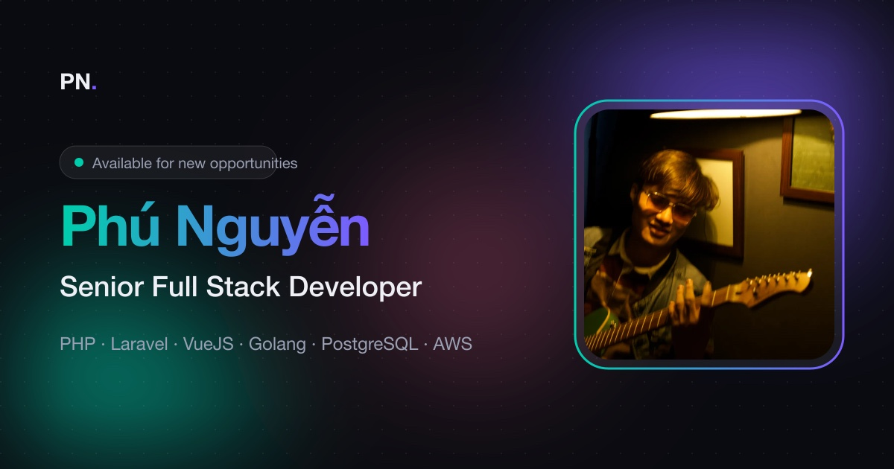

# Phú Nguyễn — Portfolio ⚡️

[English](README.md) · [](LICENSE.md)

Portfolio cá nhân của **Phú Nguyễn**, Senior Full Stack Developer. Đây là trang web tĩnh một trang, có bản tiếng Anh và tiếng Việt, dùng Parcel, Sass và JavaScript thuần, phát triển từ template [Simplefolio](https://github.com/cobiwave/simplefolio) của Jacobo Martínez.

<p align="center">
  
</p>

## Tính năng

- **Giao diện liquid glass** lấy cảm hứng từ iOS 26 của Apple: kính mờ, màu đậm, có viền phản sáng trên navbar, nút, chip và thẻ.
- **Khúc xạ ở mép kính** (Chromium): mỗi bề mặt kính bẻ cong nội dung phía sau ở gần mép. Trình duyệt khác vẫn có kính mờ, chỉ không có hiệu ứng bẻ cong.
- **Phản hồi khi bấm**: nút, icon và navbar phồng lên rồi nảy về khi bấm.
- **Giao diện tối và sáng**: theo cài đặt của máy, có nút chuyển và nhớ lựa chọn của người xem.
- **Tiếng Anh / tiếng Việt**: hai trang tĩnh `index.html` và `vi.html` sinh từ một nguồn, nên công cụ tìm kiếm lập chỉ mục được cả hai. Nút ngôn ngữ mở trang kia ở đúng phần bạn đang đọc.
- **Tab bar trên mobile**: trên điện thoại, thanh điều hướng chuyển xuống đáy màn hình thành tab bar bằng kính, dễ bấm bằng ngón cái.
- **Các phần**: Hero, Giới thiệu, Kinh nghiệm (timeline), Dự án (lưới bento), Liên hệ.
- **SEO và chia sẻ**: mỗi ngôn ngữ có tiêu đề, mô tả và URL canonical riêng, kèm link `hreflang` tới ngôn ngữ kia, cùng thẻ Open Graph và Twitter card kèm ảnh xem trước 1200×630 cho Facebook, Zalo và các nền tảng khác.
- **Nhẹ**: ảnh WebP, font variable tự host, không dùng framework CSS và không gọi tới bên thứ ba. Sau khi build còn khoảng 35 kB CSS và 6 kB JS.
- **Chạy được khi tắt JavaScript**: nội dung chỉ bị ẩn để làm hiệu ứng hiện dần khi script đã chạy.
- Tôn trọng cài đặt `prefers-reduced-motion` (giảm chuyển động).

## Bắt đầu 🚀

Cần [Node.js](https://nodejs.org/) từ bản 18 trở lên (khuyên dùng 22 LTS) và npm.

```bash
npm install
npm start
```

Mở `http://localhost:1234/`. Trang tiếng Việt ở `http://localhost:1234/vi.html`.

`npm start` sinh `src/vi.html` từ `src/index.html` và bản dịch tiếng Việt trước khi chạy. Khi dev server đang chạy, sau khi sửa nội dung hãy sinh lại bằng `npm run i18n`, hoặc để `npm run i18n -- --watch` chạy ở một terminal khác.

### Docker

Không cần cài Node trên máy:

```bash
docker compose up --build
```

Mở `http://localhost:4869/`. Dừng bằng `docker compose down`.

- Compose publish `4869:4869`. Container chạy `npm start` với `--host 0.0.0.0 --port 4869`.
- `npm start` trên máy vẫn dùng cổng 1234. Đừng mở 1234 khi đang chạy Docker.
- Repo được bind-mount tại `/app`. Volume ẩn giữ `node_modules` của container, tách khỏi cây file trên máy.
- `CHOKIDAR_USEPOLLING=true` để lưu file vẫn reload qua bind mount.

### Build

```bash
npm run build
```

Kết quả nằm trong `dist/`, thư mục này được xoá sạch trước khi build. URL của asset là đường dẫn tương đối, nên trang chạy được ở gốc tên miền lẫn trong thư mục con như `/simplefolio/`. Lệnh build cũng chép `og-image.jpg` vào gốc của `dist/`, để link Open Graph có địa chỉ cố định.

`npm run format` định dạng `src/` và `scripts/` bằng Prettier. `npm run format:check` chỉ báo cáo.

> Nếu dev server vẫn chạy code cũ sau khi sửa, hãy dừng server, xoá thư mục `.parcel-cache/` rồi chạy lại.

## Sửa nội dung 🔧

| Nội dung | File |
|----------|------|
| Nội dung tiếng Anh, link, dự án, kinh nghiệm | `src/index.html` |
| Nội dung tiếng Việt | `src/data/translations.mjs` |
| Tiêu đề trang, mô tả, từ khoá, Open Graph | phần `<head>` của `src/index.html` (bản tiếng Việt: các key `meta.*` trong `translations.mjs`) |
| Ảnh đại diện, ảnh dự án | `src/assets/` (`profile.webp`, `project.webp`) |
| CV | `docs/resume.html`, in ra `src/assets/resume.pdf` |
| Màu sắc và biến giao diện | `src/sass/abstracts/_variables.scss` |
| Hiệu ứng khi cuộn | `src/data/scrollRevealConfig.js` |

### Bản dịch

Mỗi phần tử cần dịch có một key:

- `data-i18n="key"`: chữ thường.
- `data-i18n-html="key"`: chữ có thẻ HTML, ví dụ tên tô gradient ở hero.
- `data-i18n-<thuộc tính>="key"`: một thuộc tính, ví dụ `data-i18n-content` trên thẻ `<meta>`, `data-i18n-alt` trên ảnh hay `data-i18n-aria-label` trên nút.

Chữ tiếng Anh nằm ngay trong HTML. Bản tiếng Việt đặt cùng key trong `src/data/translations.mjs`. Khi sửa nội dung, nhớ sửa cả hai nơi.

`scripts/build-vi.mjs` ghép hai nguồn này thành `src/vi.html`. File đó được sinh tự động và không commit, nên đừng sửa trực tiếp. Script báo lỗi và dừng nếu một key thiếu bản tiếng Việt, hoặc một bản tiếng Việt không còn được dùng.

### CV

`docs/resume.html` là nguồn của CV. Sửa file này, mở bằng trình duyệt rồi in ra PDF (khổ A4, không lề, bật in nền) đè lên `src/assets/resume.pdf`.

### Kinh nghiệm

Mỗi công việc là một `<li class="timeline__item">` trong `<ol class="timeline">`, mới nhất đặt trên cùng. Chấm của công việc hiện tại dùng class `timeline__dot--current` để nhấp nháy.

### Dự án

Mỗi dự án là một `<article class="bento-card">` trong `<div class="bento">`. Thẻ đầu tiên có class `bento-card--featured` và chiếm ô lớn. Trên tablet các thẻ xếp thành 2 cột, trên điện thoại thành 1 cột.

### Màu sắc

Đổi `$primary-color` và `$secondary-color` trong `_variables.scss` để đổi gradient chủ đạo. Màu theo giao diện (nền, chữ, độ ám màu của kính) là các biến CSS trong mixin `theme-dark` và `theme-light` cùng file.

### Liquid glass

- Style: mixin `liquid-glass` trong `src/sass/abstracts/_mixins.scss`. Dùng `@include liquid-glass($blur, $shadow)` để biến một phần tử bất kỳ thành kính.
- Khúc xạ và hiệu ứng bấm: `src/scripts/liquidGlass.js`. Thêm selector vào `SELECTOR` để phần tử có khúc xạ ở mép, và vào `PRESSABLE` để nó phồng lên khi bấm.

### Ảnh xem trước khi chia sẻ

`src/assets/og-image.jpg` là ảnh hiện ra khi chia sẻ link, kích thước 1200×630. Nếu thay ảnh, hãy giữ đúng kích thước này.

Các thẻ `canonical`, `hreflang`, `og:url` và `og:image` đang trỏ tới `https://phunguyen4869.github.io/simplefolio/`. Nếu bạn host ở chỗ khác, hãy sửa các URL này trong `src/index.html`. Trang tiếng Việt lấy URL từ thẻ canonical. Facebook và Zalo cần URL đầy đủ (tuyệt đối).

Sau khi deploy, kiểm tra ảnh xem trước bằng [Facebook Sharing Debugger](https://developers.facebook.com/tools/debug/). Công cụ này cũng làm mới bộ nhớ đệm của Facebook.

## Deploy 📦

`.github/workflows/gh-pages.yml` build trang và đăng thư mục `dist/` lên GitHub Pages. Bạn cũng có thể tải `dist/` lên Netlify, Vercel hoặc bất kỳ host tĩnh nào.

## Công nghệ 🛠️

- [Parcel](https://parceljs.org/): bundler
- [Sass](https://sass-lang.com/documentation): style
- [Fontsource](https://fontsource.org/): font Inter và Space Grotesk tự host
- `IntersectionObserver` và Web Animations API: hiệu ứng hiện dần khi cuộn
- SVG filter và `backdrop-filter`: hiệu ứng khúc xạ liquid glass

## Ghi công

- Template gốc: [Simplefolio](https://github.com/cobiwave/simplefolio) của [Jacobo Martínez](https://github.com/cobiwave)
- Portfolio và thiết kế lại: [Phú Nguyễn](https://github.com/phunguyen4869)

## Giấy phép 📄

MIT. Xem [LICENSE.md](LICENSE.md).
